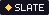
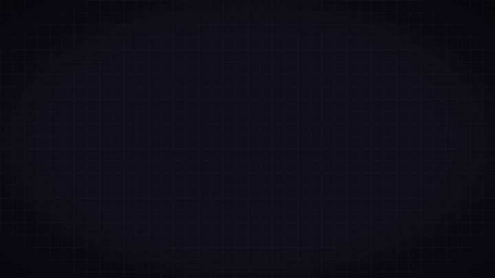

 

 
 

**A pixel game engine where your pixel art becomes a game the moment you draw it**

 

**English** · [한국어](README.ko.md)

## Install

From [Releases](https://github.com/Erzyh/slate-engine/releases/latest):

| System | File |
|---|---|
| Windows 10/11 | `Slate_x.y.z_x64-setup.exe`. When a new version comes out, the editor tells you and updates itself |
| macOS (Apple silicon / Intel) | `Slate_x.y.z_universal.dmg`. Not signed by Apple: the first time, right click the app → Open |
| Linux | `Slate_x.y.z_amd64.AppImage` (make it executable and run it) or `.deb` |

Games export to Windows (.exe), macOS (.app), Linux, Android (.apk) and the web (itch.io).

## Docs

- [Getting started](docs/en/getting-started.md): your first game from a template
- [Editor](docs/en/editor.md): project folders, the pixel and map editors, sound, exporting
- [Game code API](docs/en/api.md): Luau functions and the standard library (animation, collision, camera, dialog, menus…)

## License

- Slate: **MIT**
- Bundled font ERXPIXEL: **SIL OFL 1.1**
